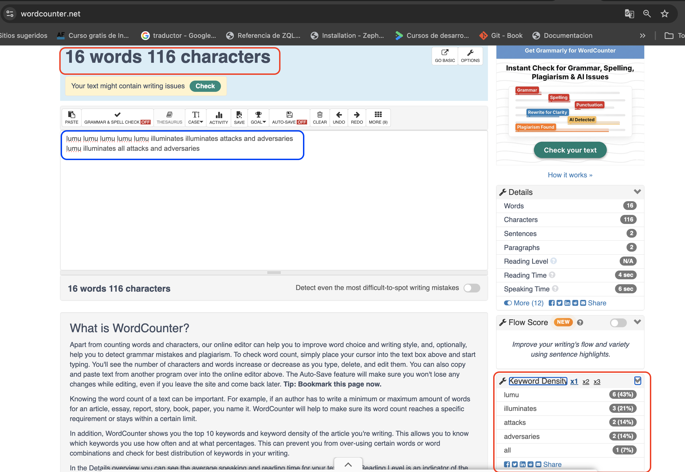
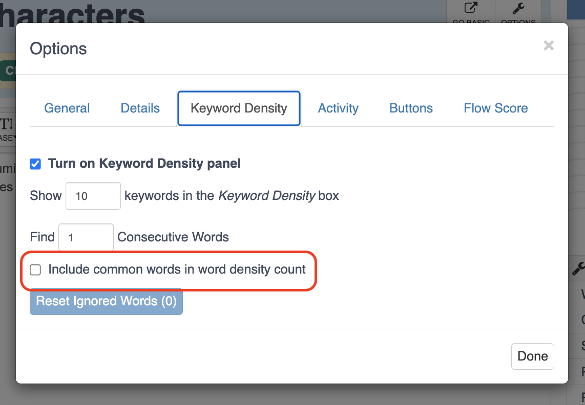
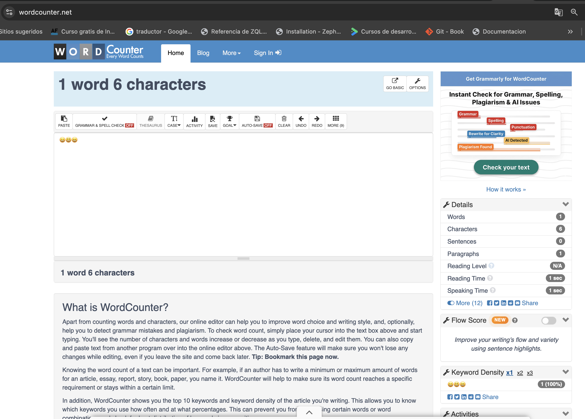

Durante las pruebas, se detectaron los siguientes hallazgos:

1. Palabras Comunes. El keyword Density excluye palabras comunes y calcula los porcentajes sin ellas, sin avisar

Pasos:
- Ingresar a https://wordcounter.net/
- Escribir el siguiente texto (dos líneas):
```
   lumu lumu lumu lumu lumu illuminates illuminates attacks and adversaries
   lumu illuminates all attacks and adversaries
```
- Validar el contador
- Validar el Keyword Density

Resultado Actual:
El keyword density toma la palabra lumu con un 43%. El usuario ve “16 palabras” arriba y porcentajes que no coinciden con ese total, sin ninguna explicación en pantalla.
Si se consideran 14 palabras entonces si es correcto, esto porq no cuenta palabras como and, the, to, yes, no. Aun y cuando en palabras y caracteres si se esta considerando



Resultado Esperado:
En el keyword Density que se indique que hay palabras excluidas y sobre qué total se calculan los porcentajes (por ejemplo, un aviso visible o la opción de incluirlas a la vista).

**Mejora** 
Luego de validar, estas palabras comunes se incluyen si se activa la opcion desde la configuracion: Options → Keyword density → “Include common word in word density count” Por lo que seria mejor si esta opcion se hace mas visible o mostrar algun mensaje en pantalla que aclara el porque del calculo de los porcentajes.

------
2. La caja de texto conserva el contenido de la visita anterior y el texto nuevo se concatena al viejo, sin avisar.
   **Por qué importa:**
   El usuario obtiene conteos más altos de lo que espera, sin ninguna señal de que parte del texto no es suyo. En pruebas automatizadas, además, un caso puede alterar el resultado de los siguientes si se reutiliza el mismo navegador.

Pasos:
- Abrir https://wordcounter.net/ por primera vez o en un navegador sin historial previo
- Escribir lumu lumu lumu illuminates illuminates attacks (6 palabras, 46 caracteres)
- Recargar la página (Observar la caja de texto)
- Cerrar Chrome por completo y volver a abrir la página (Observar la caja de texto)
- Escribir lumu lumu lumu lumu lumu illuminates illuminates attacks and adversaries seguido de un salto de línea y lumu illuminates all attacks and adversaries (16 palabras, 116 caracteres)

Resultado Actual:
En ambos casos el texto anterior sigue en la caja y el texto nuevo se escribe a continuación. El contador suma los dos textos (21 palabras y 163 caracteres, en vez de 16 y 116), y la última palabra del texto viejo se pega con la primera del nuevo y cuenta como una sola.
[Ver video: el texto anterior se conserva y se concatena](evidencias/hallazgo2-texto-concatenado.mp4)

Resultado Esperado:
Debo ver la caja vacía al cargar, o un aviso visible de que se recuperó el texto anterior, con una forma fácil de borrarlo.

**Mejora**
Al cargar, mostrar la caja vacía, o avisar que se recuperó el texto anterior y ofrecer un botón para borrarlo.

------
3. El contador de caracteres cuenta cada emoji como 2 caracteres.

Pasos:
- Abrir https://wordcounter.net/ con la caja vacía.
- Pegar 😀😃😄 (tres emojis, sin espacios).
- Mirar el contador de palabras y caracteres.

Resultado Actual:
Puedo ver que en el contador muestra 1 palabra 6 caracteres.
El resultado no coincide con lo que se ve en pantalla, por lo que resulta confuso.


Resultado Esperado:
Debo ver 1 palabra y 3 caracteres, porque el usuario ve y escribió tres símbolos.

**Mejora**
Contar cada emoji como un solo carácter visible, igual que cuenta una letra, y no por las unidades internas del texto.

